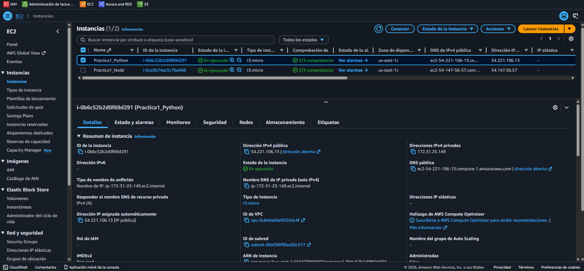
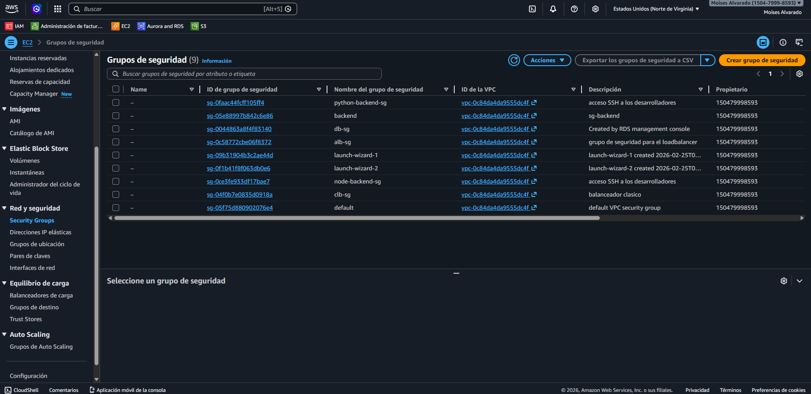
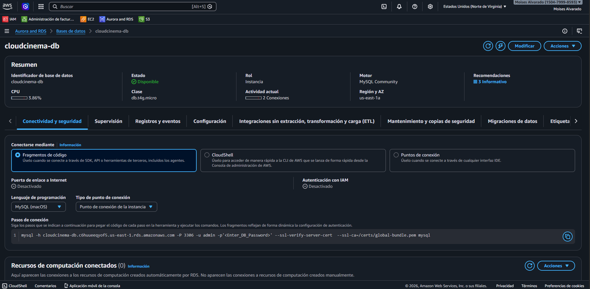
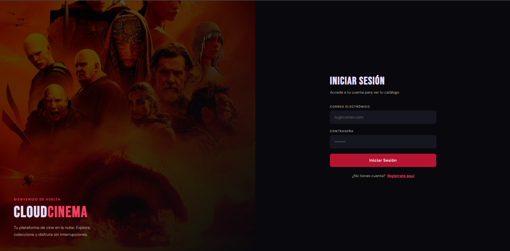
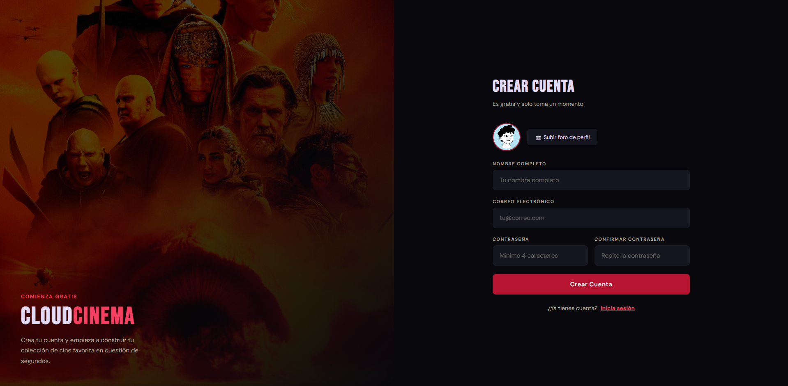
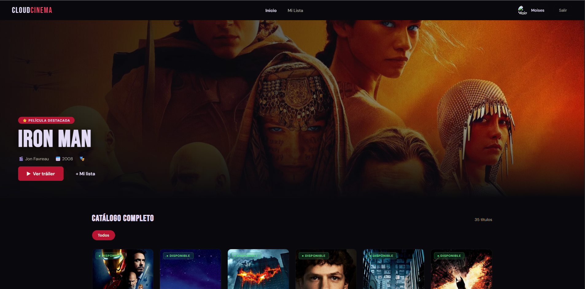
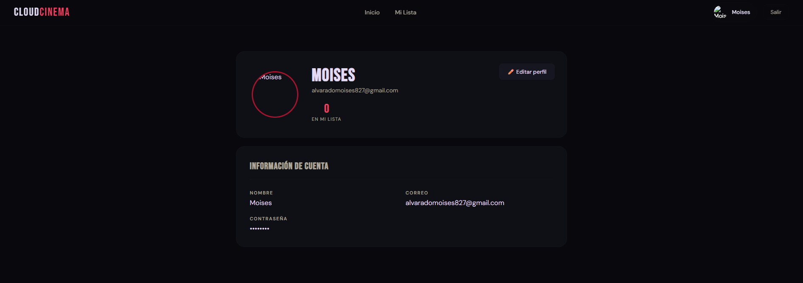
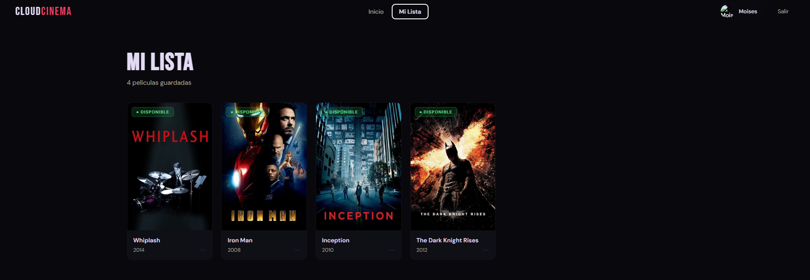
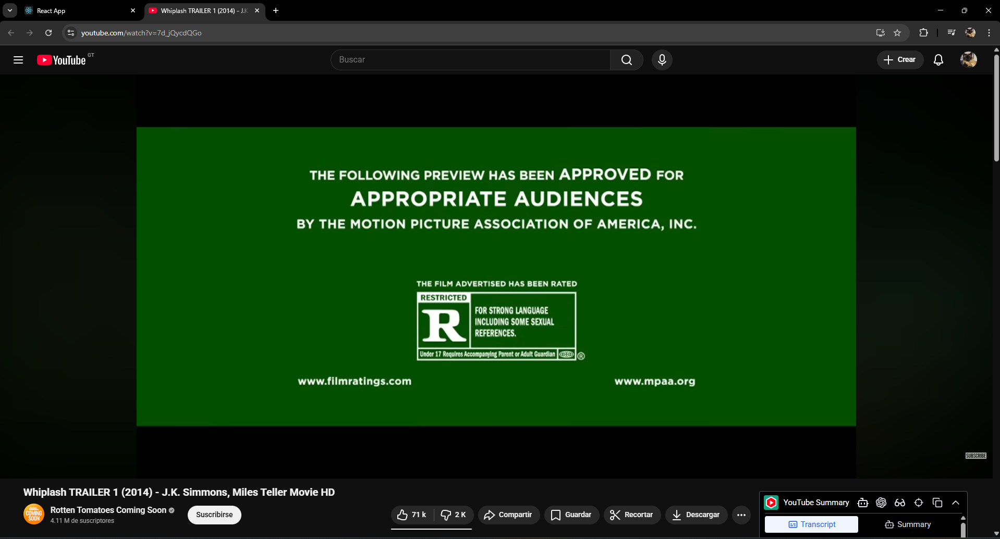

# Manual de Configuración - CloudCinema
## Práctica 1 - Seminario de Sistemas 1

---

## Datos de los Estudiantes
 
| Nombre Completo                    | Carné           |
|------------------------------------|-----------------|
| Sergio Joel Rodas Velez            | 202200271       |
| Rodrigo Sebastian Castro Aguilar   | 202204496       |
| Moisés Iván Daniel Alvarado García | 202002907       |

---

## Descripción de la Arquitectura

### Arquitectura General del Sistema

CloudCinema es una aplicación web de streaming de películas implementada con una arquitectura de tres capas alojada en la nube de AWS. El sistema permite a los usuarios registrarse, iniciar sesión, buscar películas, reproducir contenido y gestionar listas de reproducción personalizadas.

### Componentes Principales

#### 1. **Capa de Presentación**
- **Tecnología:** React.js
- **Hospedaje:** Amazon S3 
- **Características:**
  - Interfaz de usuario responsive
  - Componentes reutilizables 
  - Context API para manejo de estado global
  - Páginas: Login, Registro, Galería, Perfil, Playlist

#### 2. **Capa de Aplicación**
**Opción A: Backend Python**
- **Tecnología:** FastAPI + Uvicorn
- **Hospedaje:** Amazon EC2
- **Características:**
  - API RESTful
  - Autenticación JWT

  - Validación de datos con Pydantic
  - Endpoints para autenticación, películas, playlists y perfiles

**Opción B: Backend Node.js**
- **Tecnología:** Node.js + Express
- **Hospedaje:** Amazon EC2
- **Características:**
  - API RESTful
  - Middleware de autenticación
  - Manejo de errores centralizado
  - Endpoints equivalentes al backend Python

#### 3. **Capa de Datos**

**Base de Datos Relacional:**
- **Servicio:** Amazon RDS
- **Tablas principales:**
  - `usuarios`: Información de usuarios registrados
  - `peliculas`: Catálogo de películas disponibles
  - `lista_reproduccion`: Relación usuario-película para playlists

**Almacenamiento de Archivos:**
- **Servicio:** Amazon S3
- **Contenido almacenado:**
  - Fotos de perfil de usuarios
  - Pósters de películas

### Seguridad

1. **Autenticación y Autorización:**
   - Tokens JWT con expiración configurable
   - Hashing de contraseñas con MD5
   - Middleware de validación de tokens

2. **Seguridad de Red:**
   - Security Groups configurados para permitir solo tráfico necesario
   - HTTPS para todas las comunicaciones 

3. **IAM:**
   - Usuarios con permisos mínimos necesarios 
   - Roles EC2 para acceso a S3

---

## Usuarios IAM y Políticas

### 1. Usuario: `bd-admin`

**Propósito:** Usuario administrativo con permisos completos para gestión de la base de datos.

**Políticas Asignadas:**
- `AdministratorAccess` 
- `AmazonRDSFullAccess` 

**Uso:**
- Configuración de instancia RDS
- Creación de snapshots
- Monitoreo de base de datos

**Credenciales:**
- https://150479998593.signin.aws.amazon.com/console
- @Admin

---

### 2. Usuario: `s3-admin`

**Propósito:** Usuario administrativo con permisos completos para gestión de buckets S3.

**Políticas Asignadas:**
- `AdministratorAccess`
- `AmazonS3FullAccess`

**Uso:**
- Creación y configuración de buckets
- Subida de fotos de perfil y pósters
- Gestión de políticas de bucket
- Monitoreo de almacenamiento

**Credenciales:**
- https://150479998593.signin.aws.amazon.com/console
- @Admin

---

### 3. Usuario: `ec2-admin`

**Propósito:** Usuario administrativo con permisos completos para gestión de instancias EC2.

**Políticas Asignadas:**
- `AdministratorAccess`
- `AmazonEC2FullAccess`

**Uso:**
- Creación y configuración de instancias EC2
- Gestión de Security Groups
- Configuración de redes y subnets
- Monitoreo de instancias

**Credenciales:**
- https://150479998593.signin.aws.amazon.com/console
- @Admin

---

### 4. Usuario: `lb-admin`

**Propósito:** Usuario administrativo con permisos completos para gestión de balanceadores de carga.

**Políticas Asignadas:**
- `AdministratorAccess`
- `ElasticLoadBalancingFullAccess`

**Uso:**
- Creación y configuración de Load Balancers
- Gestión de Target Groups
- Configuración de Health Checks
- Monitoreo de tráfico

**Credenciales:**
- https://150479998593.signin.aws.amazon.com/console
- @Admin

---

## Capturas de Pantalla

### 1. Buckets de Amazon S3

#### Bucket: `cloudcinema-frontend`
**Propósito:** Almacenamiento del frontend estático

  

**Configuración:**
- Static website hosting: Habilitado
- Bucket policy: Acceso público de lectura
- Versioning: Habilitado

---

#### Bucket: `cloudcinema-media`
**Propósito:** Almacenamiento de archivos multimedia (fotos de perfil, pósters)

  

**Configuración:**
- Estructura de carpetas:
  - `/profile-pictures/`
  - `/movie-posters/`
- CORS configurado para acceso desde el frontend
- Lifecycle rules para archivos antiguos

---

### 2. Instancias EC2

#### Instancia 1: `Practica1_Python`
#### Instancia 2: `Practica1_Node`

  

**Especificaciones:**
- **Tipo de instancia:** t2.micro
- **AMI:** Amazon Linux 
- **vCPUs:** 2
- **Memoria:** 1 GB
- **Almacenamiento:** 20 GB SSD
- **Security Group 1:** `python-backend-sg`
- **Security Group 2:** `node-backend-sg`

---

#### Security Groups

  

**Reglas de Entrada (Inbound):**
| Tipo | Protocolo | Puerto | Origen | Descripción |
|------|-----------|--------|--------|-------------|
| HTTP | TCP | 80 | 0.0.0.0/0 | Tráfico HTTP |
| HTTPS | TCP | 443 | 0.0.0.0/0 | Tráfico HTTPS |
| Custom TCP | TCP | 8000 | [CLB-SG] | API FastAPI |
| Custom TCP | TCP | 8000 | [CLB-SG] | API Node.js |
| SSH | TCP | 22 | 0.0.0.0/0 | Desarrolladores |

**Reglas de Salida (Outbound):**
| Tipo | Protocolo | Puerto | Destino | Descripción |
|------|-----------|--------|---------|-------------|
| All traffic | All | All | 0.0.0.0/0 | Tráfico saliente |

---

### 3. Base de Datos RDS 

#### Instancia: `cloudcinema-db`

  

**Especificaciones:**
- **Motor:** MySQL 8.0.1
- **Clase de instancia:** db.t3.micro 
- **Almacenamiento:** 20 GB SSD de uso general

---

### 4. Aplicación Web CloudCinema

#### Página de Inicio de Sesión (Login)

  

**Características:**
- Formulario de email y contraseña
- Validación de campos
- Enlace a registro
- Mensajes de error descriptivos

---

#### Página de Registro

  

**Campos:**
- Nombre completo
- Email
- Contraseña
- Confirmación de contraseña
- Foto de perfil (opcional)

---

#### Galería de Películas

  

**Funcionalidades:**
- Grid de tarjetas de películas
- Buscador de películas
- Botón para agregar a playlist
- Vista de detalles al hacer clic

---

#### Perfil de Usuario

  

**Información mostrada:**
- Foto de perfil
- Nombre completo
- Email
- Fecha de registro
- Botón para editar perfil
- Opción para cambiar contraseña

---

#### Lista de Reproducción (Playlist)

  

**Características:**
- Lista de películas guardadas
- Botón para reproducir
- Botón para eliminar de la playlist
- Indicador de películas vacías

---

#### Reproductor de Películas

  

**Características:**
- Reproductor de YouTube embebido
- Información de la película
- Controles de reproducción
- Botón para volver a la galería

---
