## Práctica 2 - Seminario de Sistemas 1

---

## Datos de los Estudiantes
 
| Nombre Completo                    | Carné           |
|------------------------------------|-----------------|
| Sergio Joel Rodas Valdéz           | 202200271       |
| Rodrigo Sebastian Castro Aguilar   | 202204496       |
| Moisés Iván Daniel Alvarado García | 202002907       |

# Documentación AWS
## Descripción de los usuarios IAM y sus políticas

#### Descripción de los usuarios IAM

A continuación se detalla la relación de los usuarios creados en IAM (Identity and Access Management), el servicio específico al que están orientados y las políticas de permisos asignadas a cada uno para su correcto funcionamiento:

| Usuario | Servicio | Política Asignada |
| :--- | :--- | :--- |
| `user-ec2-semi1` | EC2 | `AmazonEC2FullAccess` |
| `user-s3-semi1` | S3 | `AmazonS3FullAccess` |
| `user-rds-semi1` | RDS | `AmazonRDSFullAccess` |
| `user-lambda-semi1` | Lambda | `AWSLambdaFullAccess` |
| `user-apigateway-semi1` | API Gateway | `AmazonAPIGatewayAdministrator` |

#### Usuarios creados en IAM

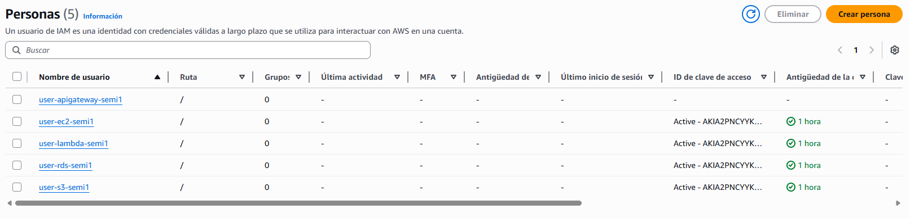

#### Descripción de Grupos de Seguridad

A continuación se detallan los grupos de seguridad configurados, incluyendo las reglas de entrada definidas para permitir el tráfico necesario hacia las instancias y servicios correspondientes.

#### Grupo de Seguridad: `ec2-nodejs-semi1`
Este grupo de seguridad está configurado para la instancia EC2 que aloja la aplicación en Node.js.

| Versión de IP | Tipo | Protocolo | Intervalo de puertos | Origen | Descripción |
| :--- | :--- | :--- | :--- | :--- | :--- |
| IPv4 | TCP personalizado | TCP | 3000 | 0.0.0.0/0 | Acceso a la aplicación Node.js |
| IPv4 | SSH | TCP | 22 | 0.0.0.0/0 | Acceso por consola a la instancia |

#### Grupo de Seguridad: `ec2-python-semi1`
Este grupo de seguridad está configurado para la instancia EC2 que aloja la aplicación en Python.

| Versión de IP | Tipo | Protocolo | Intervalo de puertos | Origen | Descripción |
| :--- | :--- | :--- | :--- | :--- | :--- |
| IPv4 | SSH | TCP | 22 | 0.0.0.0/0 | Acceso por consola a la instancia |
| IPv4 | TCP personalizado | TCP | 3000 | 0.0.0.0/0 | Acceso a la aplicación Python |

#### Grupo de Seguridad: `rds-semi1`
Este grupo de seguridad está configurado para la base de datos RDS MySQL.

| Versión de IP | Tipo | Protocolo | Intervalo de puertos | Origen | Descripción |
| :--- | :--- | :--- | :--- | :--- | :--- |
| IPv4 | MYSQL/Aurora | TCP | 3306 | 0.0.0.0/0 | Acceso a la base de datos MySQL |

## Descripción de Base de Datos (Amazon RDS)

A continuación se detallan las características principales de la instancia de base de datos relacional aprovisionada para el proyecto:

| Identificador de base de datos | Motor | Tamaño (Clase de instancia) | Región / Zona de Disponibilidad | Estado |
| :--- | :--- | :--- | :--- | :--- |
| `taskflow-db-semi1` | MySQL | `db.t3.micro` | `us-east-2c` | Disponible |

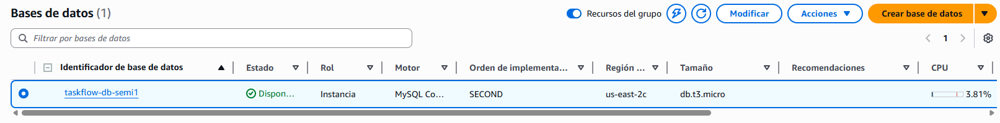

### Instancia EC2 para Node.js

Esta imagen muestra la configuración y el estado de la instancia EC2 desplegada para alojar el backend desarrollado en Node.js, incluyendo su dirección IP pública y estado de ejecución.

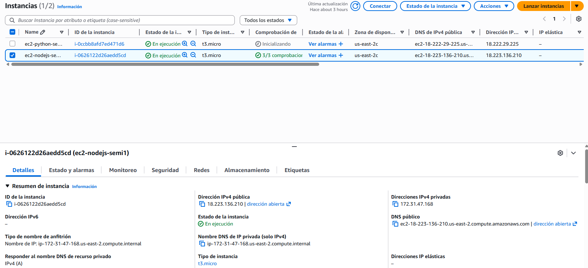

## Instancia EC2 para Python

En esta captura se puede observar el panel de administración de la instancia EC2 encargada de ejecutar nuestra API en Python, detallando su disponibilidad en la zona correspondiente.

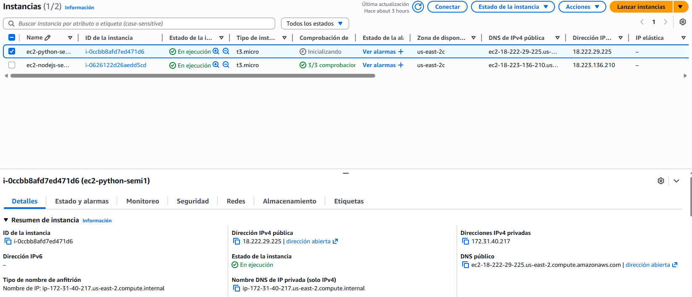

## Load Balancer Classic

Esta imagen ilustra la configuración de nuestro Balanceador de Carga Clásico, el cual se encarga de distribuir equitativamente el tráfico de red entrante entre nuestras instancias de backend (Node.js y Python) para garantizar alta disponibilidad.

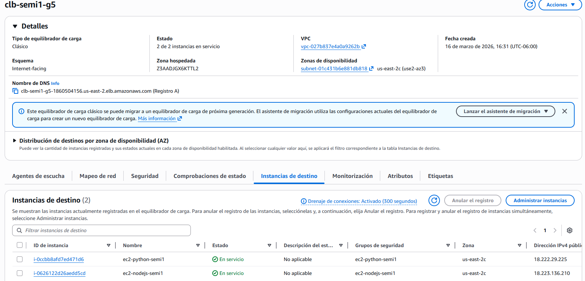

## S3 Pagina Web

Aquí se visualiza el bucket de Amazon S3 configurado específicamente para el alojamiento (hosting) de archivos estáticos, donde residen los recursos compilados del frontend (React).

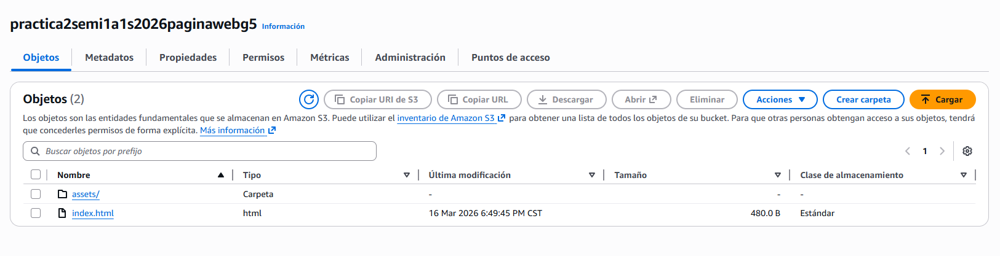

## S3 Almacenamiento de Archivos

Esta captura muestra un segundo bucket de S3, destinado exclusivamente al almacenamiento en la nube de los archivos subidos por los usuarios a través de la aplicación "Cloud Drive".

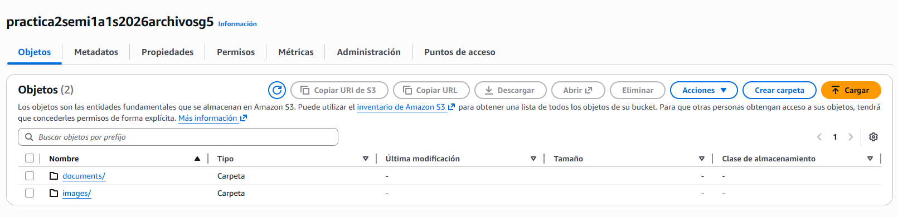

## Serverless

### Funciones Lambda

#### Funcion subir imagen S3

Esta imagen representa el panel de configuración de la función Lambda responsable de recibir las imágenes en base64 desde el frontend, procesarlas y almacenarlas permanentemente en el bucket de S3 correspondiente, retornando la URL pública generada.

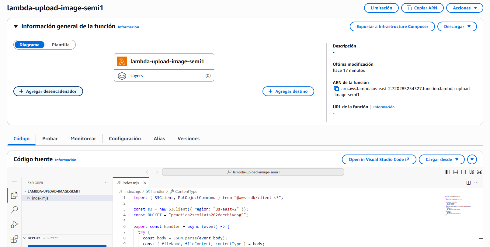

#### Funcion subir documento texto

De igual forma, aquí se detalla la función Lambda especializada en la recepción y almacenamiento seguro de documentos de texto (como PDFs) en el bucket S3, separando así la lógica según el tipo de archivo.

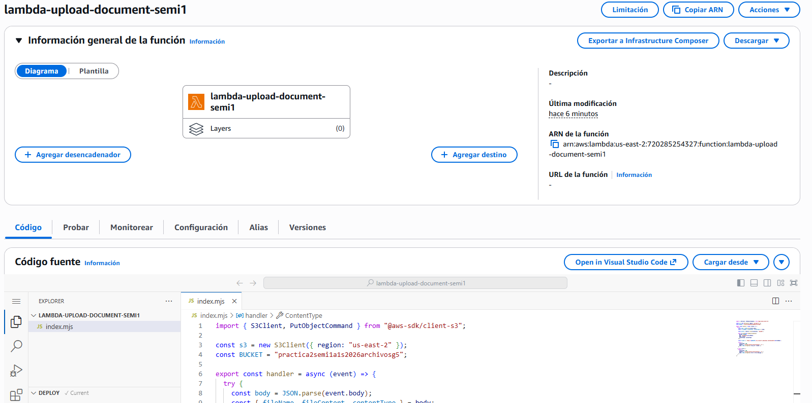

## API Gateway

En esta ilustración se expone la configuración en Amazon API Gateway, servicio que actúa como la "puerta de entrada" para nuestras aplicaciones frontend, enrutando de manera segura las peticiones HTTP hacia las funciones Lambda correspondientes para la carga de archivos.

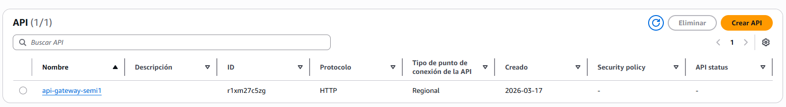

---

# Documentación Azure

#### NSG: `vm-node` y `vm-python`

| Prioridad | Nombre | Puerto | Protocolo | Origen | Destino | Acción | Descripción |
| :--- | :--- | :--- | :--- | :--- | :--- | :--- | :--- |
| 300 | SSH | 22 | TCP | Cualquiera | Cualquiera | Allow | Acceso administrativo por SSH |
| 320 | HTTP | 80 | TCP | Cualquiera | Cualquiera | Allow | Acceso web HTTP |
| 330 | Allow-API-3000 | 3000 | TCP | Cualquiera | Cualquiera | Allow | Acceso a la API Node.js en puerto 3000 |

### Máquina Virtual para Node.js

Esta imagen muestra la configuración y el estado de la máquina virtual desplegada en Azure para alojar el backend desarrollado en Node.js, incluyendo su dirección IP pública y estado de ejecución.

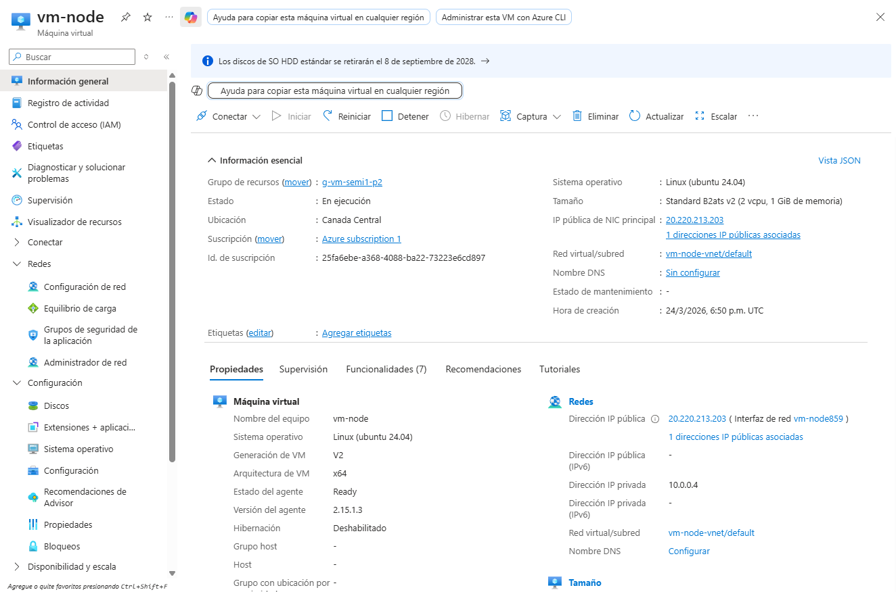

## Máquina Virtual para Python

En esta captura se puede observar el panel de administración de la máquina virtual encargada de ejecutar la API en Python, detallando su disponibilidad en la región correspondiente.

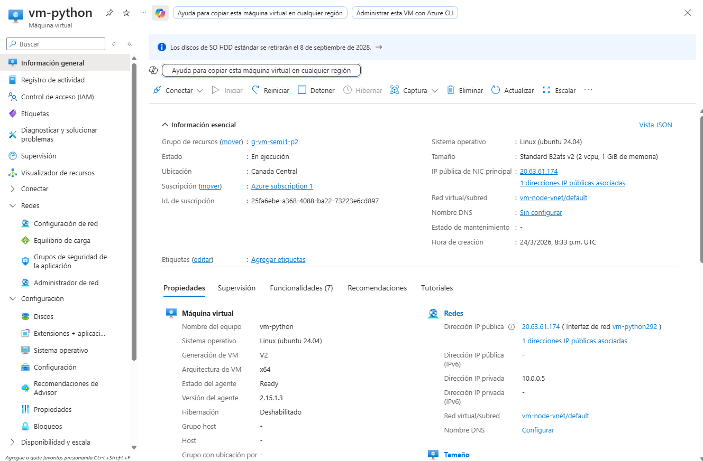

## Load Balancer

Esta imagen ilustra la configuración del Azure Load Balancer, el cual distribuye equitativamente el tráfico de red entrante entre las máquinas virtuales de backend (Node.js y Python) para garantizar alta disponibilidad.

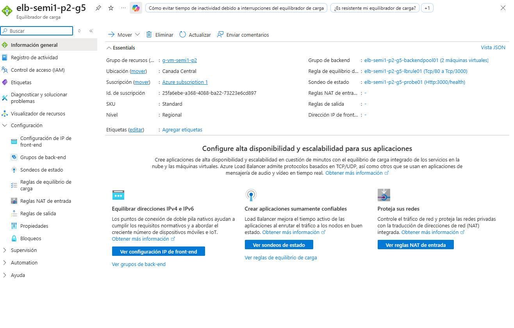

## Azure Blob Storage - Página Web (Static Website)

Aquí se visualiza el contenedor de Azure Blob Storage configurado con la funcionalidad de Static Website para el alojamiento de los archivos estáticos del frontend (React).

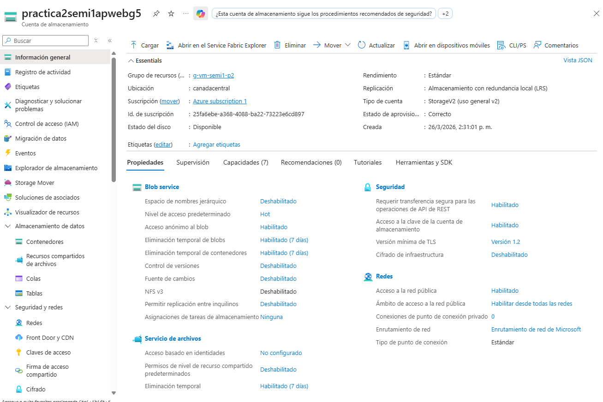

## Azure Blob Storage - Almacenamiento de Archivos

Esta captura muestra el contenedor de Blob Storage destinado exclusivamente al almacenamiento en la nube de los archivos subidos por los usuarios a través de la aplicación "Cloud Drive".

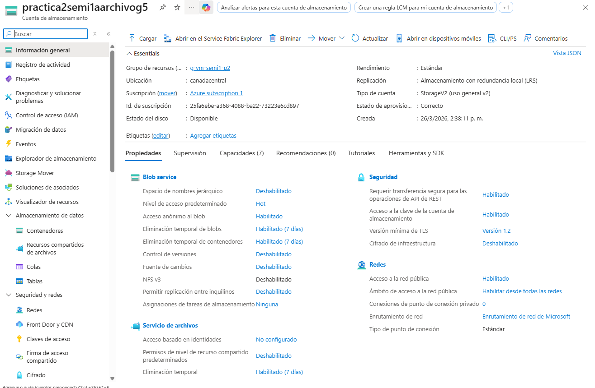

## Serverless

### Azure Functions

#### Función subir imagen a Blob Storage

Esta imagen representa el panel de configuración de la Azure Function responsable de recibir las imágenes en base64 desde el frontend, procesarlas y almacenarlas en el contenedor de Blob Storage correspondiente, retornando la URL pública generada.

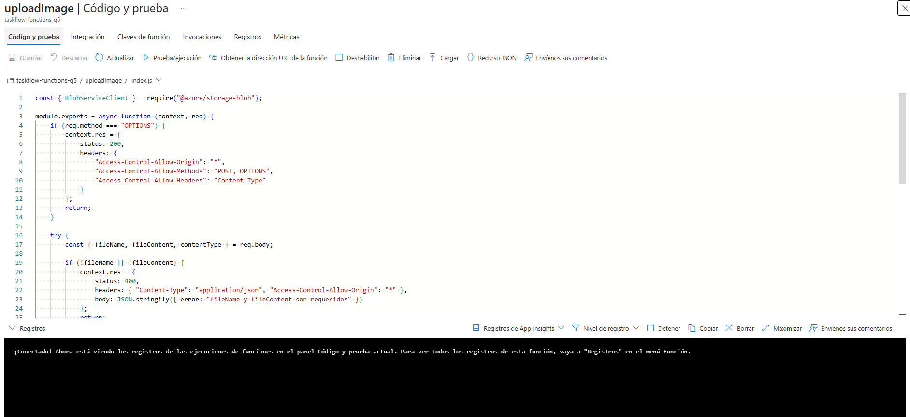

#### Función subir documento de texto

De igual forma, aquí se detalla la Azure Function especializada en la recepción y almacenamiento seguro de documentos de texto (como PDFs) en Blob Storage, separando la lógica según el tipo de archivo.

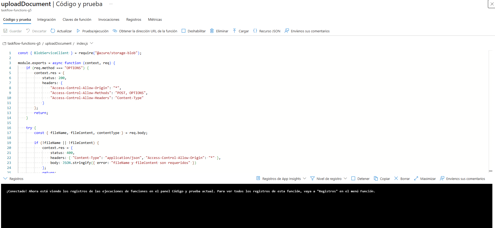

## Azure API Management

En esta ilustración se expone la configuración en Azure API Management, servicio que actúa como la "puerta de entrada" para las aplicaciones frontend, enrutando de manera segura las peticiones HTTP hacia las Azure Functions correspondientes para la carga de archivos.

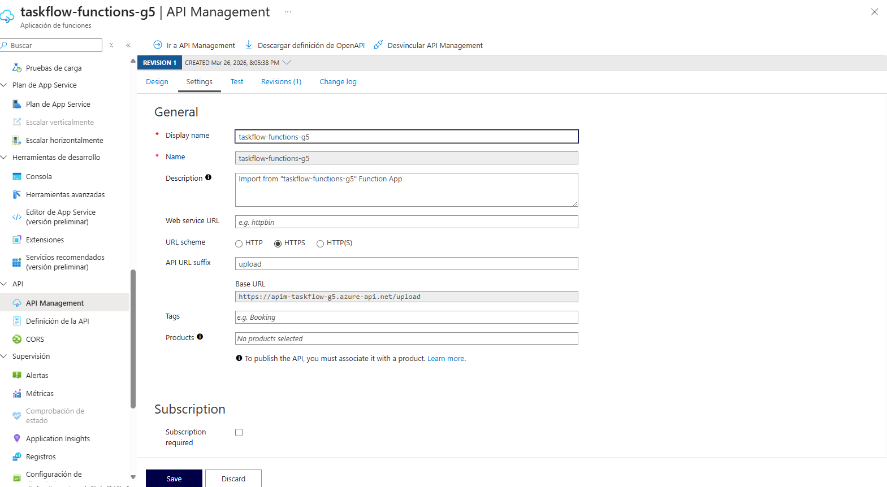
