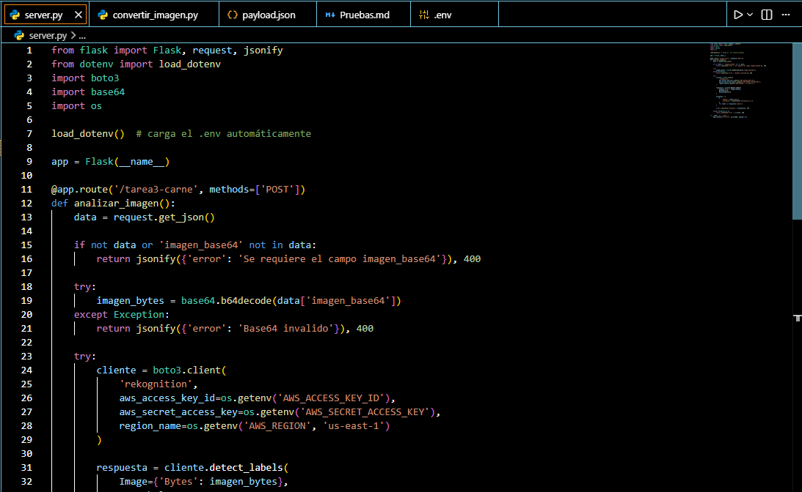
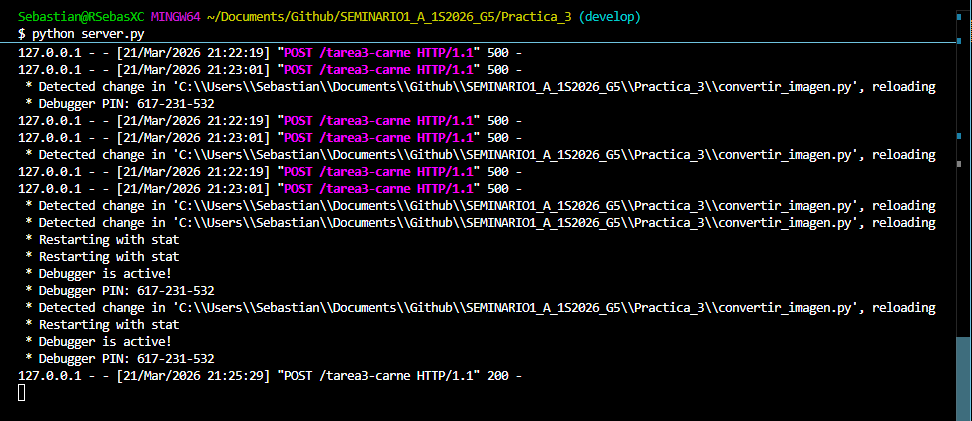
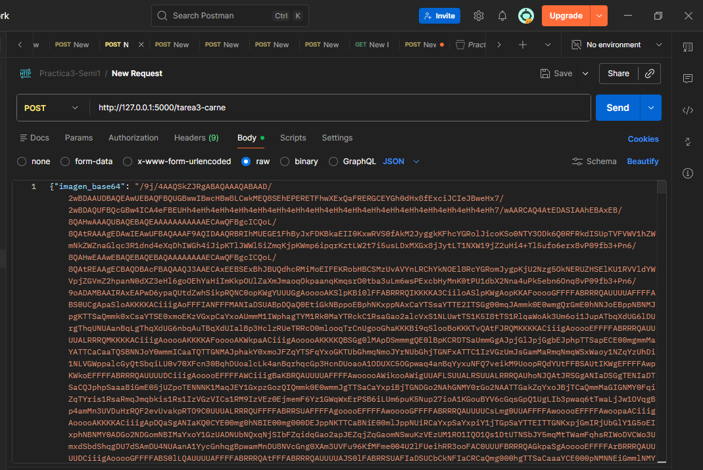
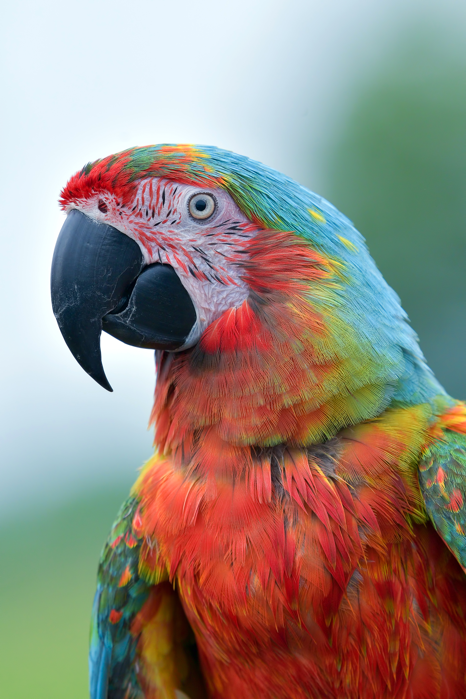
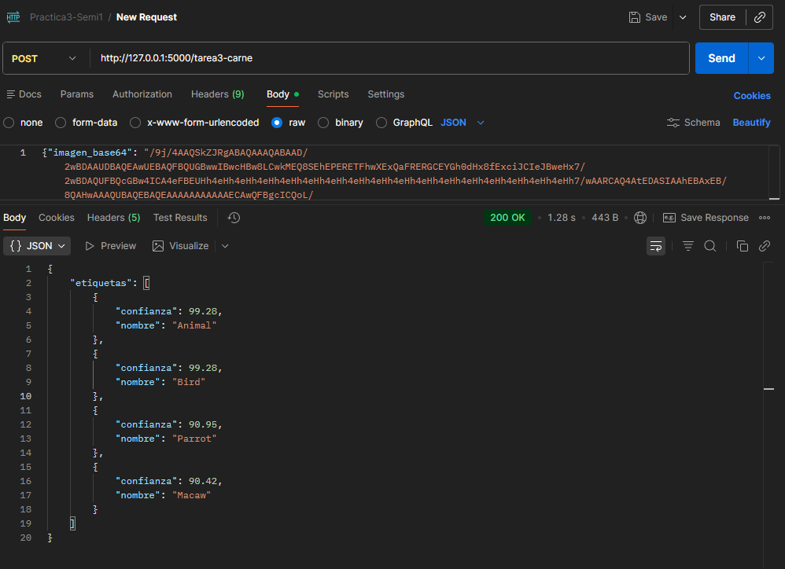

# Tarea 3 — Servidor Python con AWS Rekognition

## 1. Código del Servidor

---

## 2. Servidor Corriendo

---

## 3. Petición en Postman e Imagen Analizada

### JSON ingresado y ruta /tarea3-carne

### Imagen ingresada para análisis

---

## 4. Etiquetas devueltas por Rekognition

